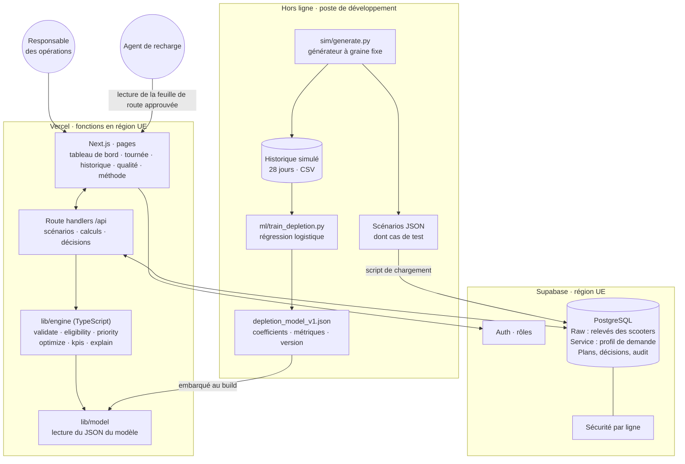
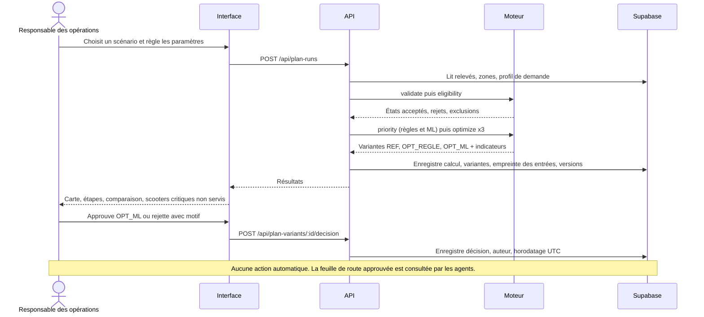
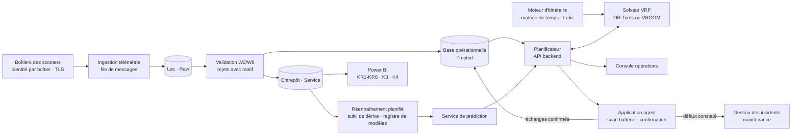

# Architecture — Planificateur de tournées de recharge BlueMove

> Workshop 9, étape 5. Deux niveaux : **MVP** (démonstration de cours, déployable sur Vercel + Supabase, données simulées) et **production** (pilote réel). Les choix sont justifiés dans `DECISIONS.md` (D-06 à D-15) ; le détail d'implémentation figure dans `MVP_SPEC.md`.

---

## 1. Vue d'ensemble de la chaîne de décision

Sources de données → contrôles qualité → données exploitables → composant prédictif → moteur d'optimisation → API / backend → interface → validation humaine → suivi des résultats.

```mermaid
flowchart LR
    subgraph S["1 · Sources"]
        S1["État des scooters<br/>GPS · BMS · statut de location"]
        S2["Profil de demande<br/>zone × créneau, 28 jours"]
        S3["Référentiels<br/>zones · dépôt · cibles"]
        S4["Paramètres de l'opérateur<br/>agents · véhicule · durée · zones fermées"]
    end

    subgraph Q["2 · Contrôles qualité"]
        Q1["Rejets qualité<br/>doublon · charge hors 0-100 %<br/>coordonnées · association batterie"]
        Q2["Exclusions métier<br/>loué · réservé · maintenance<br/>données périmées · zone fermée<br/>alerte BMS vers maintenance"]
    end

    subgraph D["3 · Données exploitables"]
        D1["Candidats à la recharge<br/>critiques moins de 20 %<br/>préventifs 20-40 %"]
    end

    subgraph P["4 · Priorisation"]
        P1["Modèle ML<br/>risque de passer sous 20 % en 3 h"]
        P2["Score de priorité<br/>urgence · demande · rareté"]
    end

    subgraph O["5 · Optimisation"]
        O1["Sélection et tournées<br/>temps · batteries · retour dépôt"]
        O2["3 variantes<br/>REF · OPT_REGLE · OPT_ML"]
    end

    subgraph U["6 · Décision"]
        U1["Tableau de bord<br/>carte · priorités · comparaison"]
        U2{"Responsable des opérations<br/>approuve ou rejette"}
    end

    subgraph M["7 · Suivi"]
        M1["Journal d'audit<br/>données · versions · décision"]
        M2["Indicateurs KR1-KR6<br/>K3 et K4 en garde"]
    end

    S1 --> Q1 --> Q2 --> D1
    S3 --> Q2
    S4 --> Q2
    D1 --> P1 --> P2
    S2 --> P2
    D1 --> P2
    P2 --> O1 --> O2 --> U1 --> U2
    S4 --> O1
    U2 -->|approuvé| M1
    U2 -->|rejeté avec motif| M1
    M1 --> M2
    M2 -.->|réglage des paramètres<br/>et réentraînement| P1
```

**Ce qui relève de l'IA** : uniquement le bloc P1 (modèle appris à partir de l'historique). **Ce qui relève de règles** : Q1, Q2, D1, P2 (formule transparente). **Ce qui relève de l'optimisation classique** : O1.

---

## 2. Architecture MVP (cours)

### 2.1 Composants et rôle

| Composant | Rôle | Technologie | Justification |
|---|---|---|---|
| Générateur de simulation | Crée la flotte, l'historique 28 jours et les scénarios de test | Python (numpy, pandas) | Aucune donnée réelle disponible ; graine fixe pour reproductibilité |
| Entraînement ML | Entraîne et évalue le modèle de risque d'épuisement, exporte un JSON versionné | Python (scikit-learn) | Hors ligne : pas de serveur de modèle à maintenir |
| Interface | Tableau de bord, paramètres, priorités, carte des tournées, comparaison, décision, historique | Next.js, React, Tailwind, Leaflet | Déploiement natif sur Vercel |
| API | Lecture des scénarios, lancement d'un calcul, enregistrement des décisions | Route handlers Next.js (runtime Node) | Une seule base de code |
| Moteur | Contrôles, éligibilité, priorité, optimisation, indicateurs, explications | TypeScript pur, testé (Vitest) | Déterministe, rapide, auditable |
| Base de données | Scénarios, relevés bruts, profils, plans, décisions, journal | Supabase PostgreSQL (UE) | Cohérent avec W2 et W8 |
| Authentification | Comptes et rôles | Supabase Auth | Droits par métier (W2, W8) |

### 2.2 Correspondance avec les niveaux de données du W2

| Niveau W2 | Dans le MVP |
|---|---|
| **Raw** | `scooter_readings` : relevés tels que reçus par scénario, anomalies comprises |
| **Trusted** | Résultat de `validate()` : états acceptés, rejets avec motif (`validation_results`) |
| **Service** | `demand_profile` (agrégats zone × créneau), candidats éligibles, plans et indicateurs |

La validation est exécutée par le moteur à chaque calcul et son résultat est **enregistré avec le plan**, ce qui rend visible le contrôle qualité et respecte la règle « seules les données acceptées modifient l'état courant » [R W2].

### 2.3 API du MVP

| Méthode | Route | Rôle autorisé | Effet |
|---|---|---|---|
| GET | `/api/scenarios` | tous | Liste des scénarios simulés |
| GET | `/api/scenarios/{id}` | tous | Scénario + état validé + candidats (sans calcul de tournée) |
| POST | `/api/plan-runs` | responsable_ops | Lance un calcul : 3 variantes enregistrées avec statut `proposee` |
| GET | `/api/plan-runs/{id}` | tous | Variantes, étapes, indicateurs, exclusions |
| POST | `/api/plan-variants/{id}/decision` | responsable_ops | Approuve ou rejette (motif obligatoire si rejet) |
| GET | `/api/plan-runs` | tous | Historique des calculs et décisions |
| GET | `/api/model` | tous | Version, date, origine des données et métriques du modèle |

Aucune route n'émet de commande vers un scooter ou un système externe.

### 2.4 Règles de décision encodées

| Étape | Règle | Source |
|---|---|---|
| Rejet qualité | Doublon de message, charge hors [0 ; 100], coordonnées invalides, batterie non associée au scooter | W2, W8 |
| Exclusion métier | En location, réservé, en maintenance ou hors service, hors zone autorisée, zone marquée inaccessible | Cadre commun, W4 |
| Exclusion fraîcheur | GPS > 10 min, BMS > 30 min à l'instant du scénario | H12 |
| Orientation maintenance | Code défaut BMS ou température batterie anormale : pas de recharge, signalement | W3, D-05 |
| Éligibilité | Charge < 40 % ; critique si < 20 % | Cadre commun, H10 |
| Priorité | `100 × (0,50 × urgence + 0,35 × demande + 0,15 × rareté)` | H13, `MVP_SPEC.md` §7 |
| Contraintes dures | Durée de tournée ≤ T ; échanges ≤ batteries transportées ; départ et retour au dépôt | H03–H06 |
| Validation | Aucun plan exécutable sans approbation ; expiration à 30 min | D-13, H18 |

---

## 3. Flux d'une décision

---

## 4. Sécurité, protection des données et supervision

### 4.1 Rôles et droits (MVP)

| Rôle | Peut lire | Peut écrire | Correspondance W2 / W8 |
|---|---|---|---|
| `responsable_ops` | Tout | Calculs, décisions | Responsable métier exploitation |
| `agent` | Tournées **approuvées** qui lui sont attribuées | Rien | Exploitation terrain, droits limités |
| `lecteur` | Tout, en lecture seule | Rien | Démonstration, enseignant, analyste |

Mise en œuvre : Supabase Auth, politiques de **sécurité par ligne** sur `plan_decisions` et `plan_runs` ; la clé de service Supabase n'est utilisée que côté serveur (variable d'environnement Vercel), jamais exposée au navigateur. Double authentification recommandée pour les comptes `responsable_ops` (W7).

### 4.2 Données personnelles

| Sujet | Mesure |
|---|---|
| Clients | Aucune donnée client. La demande n'est utilisée qu'**agrégée par zone et créneau**. Aucun historique de trajet. |
| Positions des scooters | Seule la position **courante** des scooters **libres** est utilisée, comme dans l'application client. |
| Agents | Aucune géolocalisation dans le MVP ; agents désignés « Agent 1, 2, 3 ». En production : finalité limitée, information préalable, pas d'évaluation individuelle par la trace, conservation courte (D-15). |
| Hébergement | Supabase en région UE ; fonctions Vercel en région UE. L'hébergement en Europe ne suffit pas à garantir la conformité [R W2]. |

### 4.3 Risques W7 appliqués à l'outil

| Risque | Effet sur l'outil | Mesure |
|---|---|---|
| Mesure batterie falsifiée (capteurs et commandes, critique) | Priorités et tournées faussées | Rejet des valeurs impossibles ; en production, identité par boîtier et détection de sauts incohérents ; vérification sur place par l'agent |
| Accès non autorisé | Consultation des positions de la flotte | Rôles, sécurité par ligne, journal des accès |
| Indisponibilité de la plateforme | Pas de tournée calculée | Repli : planification manuelle (variante REF exportable) |

### 4.4 Traçabilité et supervision

Chaque calcul enregistre : identifiant du scénario, instant `as_of` (UTC), **empreinte SHA-256 des entrées**, paramètres, version du moteur, version du modèle (ou « désactivé »), nombre de rejets et d'exclusions par motif, durée de calcul, indicateurs, puis la décision (auteur, horodatage, motif). Cela met en œuvre la règle du cadre commun : « chaque recommandation conserve ses données, la version du calcul, la décision et le résultat ».

Supervision du MVP : page « Historique » (taux d'acceptation, motifs de rejet) et page « Méthode » (métriques du modèle, origine des données). En production : alertes si le taux de rejets qualité dépasse 5 %, si le modèle est désactivé par repli, ou si la durée de calcul dépasse 10 s.

---

## 5. Coûts et déploiement

| Poste | MVP | Production |
|---|---|---|
| Hébergement web | Vercel, offre d'entrée suffisante pour une démonstration | Offre professionnelle, région UE |
| Base de données | Supabase, offre d'entrée, région UE | Instance dimensionnée, sauvegardes testées (W2, W7) |
| Calcul d'optimisation | Inclus dans la fonction serveur (< 5 s pour 300 scooters) | Service de solveur dédié (conteneur) |
| Temps de parcours | Approximation sans coût | Moteur d'itinéraire auto-hébergé ou API payante |
| ML | Entraînement local, aucun coût d'exécution | Réentraînement mensuel planifié, suivi de dérive |
| LLM | **Aucun** | Aucun prévu |

Les tarifs exacts des offres ne sont pas fixés ici ; ils sont à vérifier au moment du déploiement.

---

## 6. Évolutions pour la production

| Évolution | Apport | Prérequis |
|---|---|---|
| Ingestion télémétrie réelle | Données à jour, fin de la simulation | Flux GPS/BMS conformes (W3) |
| Solveur VRP dédié | Meilleures tournées, fenêtres horaires, plusieurs dépôts | Volume et contraintes confirmés |
| Matrice routière et trafic | Temps réalistes ; exploitation des données trafic et travaux prévues au W1 | Choix d'un moteur d'itinéraire |
| Application agent | Confirmation par scan de la batterie, retour terrain, signalement maintenance | Encadrement de la géolocalisation des salariés |
| Réoptimisation en cours de tournée | Réaction aux imprévus | Position des agents, règles de remplacement d'un plan approuvé |
| Modèle gradient boosting | Gain prédictif éventuel | Doit battre la régression logistique sur données réelles |
| Scénario « collecte au dépôt » | Si le mode de recharge réel l'exige | Capacité en places, couplage avec repositionnement et K6 |
| Intégration Power BI | Indicateurs dans le tableau de bord W6 | Modèle en étoile et droits configurés (W6) |
