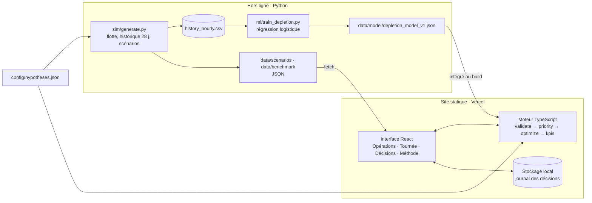

# Implémentation du MVP — BlueMove Recharge Planner

> Ce document décrit ce qui a **réellement** été construit, les algorithmes, la séparation entre règles, optimisation, ML et décision humaine, et les écarts par rapport à `MVP_SPEC.md`. Les justifications détaillées des écarts figurent dans `DECISIONS.md` (D-17 à D-27).

## 1. Architecture réellement implémentée

| Couche | Fichiers | Rôle |
|---|---|---|
| Paramètres | `config/hypotheses.json` | Hypothèses H01–H27, seuils, bornes de saisie, véhicules, profil de demande W5 |
| Simulation | `sim/generate.py` | 300 scooters, 20 jours ouvrés au pas de 30 min, politique d'échange historique, 3 scénarios, 6 cas de test, 15 instants de banc d'essai, fixtures de contrôle croisé |
| Modèle | `ml/train_depletion.py` | Entraînement, évaluation temporelle, comparaison à la règle, export JSON, `ml/report.md` |
| Moteur | `src/engine/*.ts` | Fonctions pures et déterministes ; aucune dépendance à l'interface |
| Interface | `src/ui/*.tsx`, `src/styles.css` | Tableau de bord, paramètres, carte SVG, résultats, comparaison, décision, historique, méthode |
| Build | `build.mjs`, `vercel.json` | esbuild → `dist/` (HTML, JS, CSS, données JSON) |
| Tests | `tests/engine.test.ts`, `scripts/benchmark.ts` | 23 tests ; banc d'essai reproductible |

### Correspondance avec les niveaux de données du W2
- **Raw** : relevés des scénarios (`readings`), anomalies comprises.
- **Trusted** : sortie de `validateScenario` (un état par scooter, rejets et exclusions motivés).
- **Service** : candidats priorisés, statistiques de zone, variantes et indicateurs.

## 2. Algorithmes

### 2.1 Contrôles et éligibilité (règles) — `validate.ts`
Ordre d'application, premier motif retenu :
1. **Rejets qualité** : doublon de message ; champ manquant ; charge hors [0 ; 100] ; coordonnées invalides ou (0,0) ; horodatage futur ou illisible ; batterie différente du registre ; statut inconnu.
2. **Orientation maintenance** : code défaut BMS ou température > 55 °C (H24).
3. **Exclusions métier** : maintenance / hors service ; en location ; réservé ; GPS > 10 min ; BMS > 30 min ; hors zone ; zone fermée ; charge ≥ seuil d'intervention.
4. Les scooters restants sont **candidats** : *critiques* (< 20 %) ou *préventifs*.

La **louabilité** (cadre commun : libre, actif, zone, GPS < 2 min, BMS < 10 min, ≥ 20 %) est calculée séparément : elle sert à la rareté de zone et aux indicateurs, jamais à l'éligibilité.

### 2.2 Priorité (règle) — `priority.ts`, `demand.ts`
`priorité = 100 × (wU × urgence + wD × demande + wS × rareté)`, poids normalisés.
- **Demande** D : recherches attendues dans la zone sur 3 h (profil W5, chevauchement des créneaux), divisées par le maximum des zones.
- **Rareté** S : `(cible − louables) / cible`, bornée à [0 ; 1].
- **Urgence** U : 1 pour un critique ; pour un préventif, `0,8 × (seuil − charge) / (seuil − 20)` sans ML, ou `0,8 × p` avec ML.
- Poids par défaut **0,50 / 0,10 / 0,40** (recalibrés, D-25) ; poids de conception 0,50 / 0,35 / 0,15 disponibles en un clic.
- Chaque candidat porte une **explication** générée par gabarit.

### 2.3 Modèle prédictif (seule brique d'apprentissage) — `ml/train_depletion.py`, `model.ts`
- **Cible** : la charge passe sous 20 % dans les 3 h, sans échange entre-temps (lignes censurées écartées).
- **Variables** : charge, trajets du scooter sur 6 h, demande attendue de la zone (mise à l'échelle et météo), pluie.
- **Découpage temporel** : jours 1–15 apprentissage (14 353 lignes), jours 16–20 test (4 860 lignes).
- **Résultats (simulation)** : AUC 0,767 contre 0,743 pour la règle « charge croissante » ; précision@10 0,313 contre 0,305 ; Brier 0,112 contre 0,129 (taux constant). Le gain est faible (D-27).
- **Inférence** : coefficients standardisés lus depuis le JSON ; l'inférence TypeScript est vérifiée égale à scikit-learn à 10⁻⁹ près (fixtures).
- **Garde-fous** : modèle invalide ou désactivé → variante « + ML » non calculée, recommandation entre les deux autres.

### 2.4 Construction des tournées (optimisation classique) — `optimize.ts`
Modèle commun : temps de trajet = haversine × détour ÷ vitesse ; durée = trajets aller-retour + 6 min par échange ; contraintes dures : durée ≤ T, échanges ≤ batteries transportées, une visite par scooter, départ et retour au point choisi.
- **Référence (REF)** : critiques uniquement ; l'agent le moins avancé prend le critique le plus proche tant que le retour reste possible.
- **Optimisée (OPT)** : jusqu'à 3 passes de (1) insertion gloutonne maximisant `priorité / minutes ajoutées` à la meilleure position et dans le meilleur agent, (2) amélioration **2-opt** de chaque tournée, (3) **échanges** d'un scooter servi contre un non servi de priorité supérieure si la tournée reste admissible. Départages explicites → résultat déterministe.
- **Vérification** : lorsque la capacité est la contrainte active, la somme des priorités servies atteint exactement celle des meilleurs candidats (contrôlé sur SC01–SC03).
- **Aucune tournée admissible** : tournées vides et message explicite (aucun candidat, zones toutes fermées, durée insuffisante).
- **Non retenus** : motif « Capacité batteries atteinte », « Temps insuffisant », « Hors règle de référence » ou « Non retenu par la règle du plus proche voisin ».

### 2.5 Indicateurs et recommandation — `kpis.ts`, `run.ts`
- KR1 coût par recharge, KR2 recharges par heure-agent, KR3 km par recharge, KR4 / KR4b couverture des critiques, projection à 3 h (déficit pondéré par la demande, scooters projetés < 20 %). KR6 (taux d'acceptation) est calculé dans le journal. Division par zéro → « ND ».
- **Recommandation** : plus faible déficit projeté ; à moins de 1 % d'écart, meilleure couverture des critiques ; puis coût par recharge. **La référence peut être recommandée** (c'est le cas sur SC03 avec les paramètres par défaut).
- **Traçabilité** : empreinte SHA-256 des entrées (relevés, paramètres, versions), versions du moteur, du modèle et des hypothèses, durée de calcul.

## 3. Fonctions opérationnelles de l'interface

| Écran | Contenu |
|---|---|
| **Opérations** | 6 indicateurs ; plan schématique (survol et détail : identifiant, position, batterie, statut, priorité, fraîcheur) ; paramètres ; onglets Priorités (décomposition du score), Contrôles qualité, Orientés maintenance, Zones |
| **Tournée** | Métadonnées du calcul, 3 variantes avec étoile sur la recommandée, indicateurs, carte des itinéraires numérotés, ordre des arrêts par agent avec heures, validation humaine (approbation, rejet motivé, expiration), comparaison chiffrée et barres, non retenus, paramètres et logique, feuille de route imprimable |
| **Décisions** | Journal local, KR6, part des recommandations suivies, motifs de rejet |
| **Méthode** | Règles / optimisation / ML / humain ; fiche du modèle ; hypothèses ; limites ; banc d'essai recalculé dans le navigateur |

Badge permanent « Données de démonstration » et mention en pied de page.

## 4. Écarts par rapport à `MVP_SPEC.md`

| Spécification | Réalisé | Raison |
|---|---|---|
| Next.js, route `POST /api/plan-runs` | React + esbuild, calcul dans le navigateur | Registre npm inaccessible pendant le développement : seul un build vérifiable a été retenu (D-17, D-19) |
| Supabase, rôles, sécurité par ligne | Journal en stockage local, sans compte | Données simulées, pas de valeur ajoutée pour la démonstration (D-18) ; schéma conservé pour le pilote |
| Leaflet + OpenStreetMap | Plan SVG schématique | Pas de dépendance externe, pas de fausse géographie (D-20) |
| Poids 0,50 / 0,35 / 0,15 | 0,50 / 0,10 / 0,40 par défaut | Recalibrage documenté (D-25) |
| SC01 à 07 h 30 | 06 h 30 | Avant la tournée simulée de 07 h 00 (D-21) |
| Un dépôt | Deux points de départ au choix | Paramètre demandé par la consigne de développement (D-22) |
| — | Banc d'essai de 15 situations | Robustesse de la comparaison (D-26) |
| AC-18, AC-22 (rôles) | Non implémentés | Pas d'authentification (D-18) |
| AC-13 sur Vercel (< 5 s) | 40–120 ms dans le navigateur, < 2 s vérifié en test | Calcul client |

## 5. Vérifications de qualité

- Tests du moteur : 23 / 23 (voir `TESTS.md`).
- `tsc --noEmit` strict sur le moteur et les tests : sans erreur.
- Build de production : `dist/assets/app.js` ≈ 290 Ko, `app.css` ≈ 13 Ko.
- Parcours complet automatisé dans Chromium (bureau 1440 px et mobile 390 px) : aucune erreur JavaScript, aucun débordement horizontal sur mobile.
- Limite : la vérification TypeScript des composants React n'a pas pu être exécutée dans l'environnement de développement (types `@types/react` non installables hors ligne) ; elle s'exécute avec `npm run typecheck` après `npm install`.
