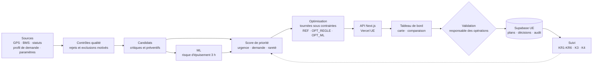

# Workshop 9 — Conception d'une application IA
## BlueMove · Consigne E : optimiser les trajets de rechargement

**Groupe 3 — DATA+AI in Corporate Strategy, ESSEC Global BBA**
**Documents associés** : `GRILLE_IA_JUSTIFICATIONS.md` et classeur `GRILLE_IA_2026_BlueMove_Groupe3.xlsx` · `ARCHITECTURE.md` · `MVP_SPEC.md` · `BLUEMOVE_CONTEXT.md` · `DECISIONS.md`

---

## Synthèse

**Problème.** Les scooters dont la batterie passe sous 20 % ne sont plus louables. Une planification des recharges fondée sur un seuil fixe et un ordre de visite « au plus proche » traite tous les scooters de la même façon, quel que soit leur emplacement ou la demande à venir, et respecte mal ensemble les contraintes de temps et de batteries transportées.

**Proposition.** Un outil d'aide à la décision qui, à chaque prise de poste, sélectionne les scooters à recharger, les classe selon une priorité explicable, construit les tournées des agents sous contraintes et compare le résultat à une planification de référence. Le responsable des opérations approuve ou rejette ; rien n'est exécuté automatiquement.

**Place de l'IA.** Le cœur de la solution est une **optimisation de tournées** (recherche opérationnelle), qui n'est pas de l'apprentissage automatique. L'IA intervient sur un point précis : un **modèle prédictif** estime si un scooter encore louable passera sous 20 % dans les trois heures. Ce composant est **conditionnel** : il n'est conservé que s'il fait mieux qu'une règle simple sur données réelles.

**Évaluation.** Grille IA 2026 : **153 / 220**, « IA potentiellement utile, à confirmer ». Décision : **Go sous conditions**.

**Prototype.** Application web (Next.js sur Vercel, Supabase en région UE) fonctionnant sur données **simulées**, qui calcule trois variantes — référence, optimisation sans ML, optimisation avec ML — pour isoler l'apport de chaque brique.

### Problématique retenue
> *Comment BlueMove peut-elle choisir, à chaque prise de poste, quelles batteries échanger, dans quel ordre et par quel agent, afin de maintenir des scooters louables là et quand la demande est forte, au moindre coût d'intervention et sous le contrôle d'un opérateur ?*

La formulation initiale a été précisée sur trois points : le **mode de recharge** retenu comme hypothèse (échange de batterie), l'objectif de **louabilité dans les zones demandées** plutôt que de simple réduction des kilomètres, et le maintien d'une **décision humaine**.

---

## 0. Démarche suivie

| Étape de travail | Ce que nous avons fait |
|---|---|
| Lecture des sources | Consignes et pages 16 à 21 du module 9 ; rapport des workshops 1 à 8 ; classeur de la grille 2026 |
| Hiérarchie | Module 9 = ce qu'il faut rendre ; rapport W1–8 = contexte et décisions acquises ; classeur = méthode de notation |
| Extraction | Définitions, règles de qualité, indicateurs, gouvernance (consignés dans `BLUEMOVE_CONTEXT.md`) |
| Écarts | Six contradictions ou lacunes identifiées et traitées (`DECISIONS.md` §3) |
| Hypothèses | Registre H01–H26, toutes réversibles et rattachées à un interlocuteur de validation |
| Cohérence | Vérification croisée grille ↔ approche ↔ architecture ↔ cahier des charges |

**Constat clé de la lecture** : notre rapport W3 avait déjà esquissé la réponse — « combiner la charge, la position et l'activité attendue pour proposer une tournée ; comparer d'abord le résultat à une règle simple ». Le Workshop 9 transforme cette intention en solution évaluable.

---

## Étape 1 — Définir le problème métier

### Journal de décision
| | |
|---|---|
| **Question** | Quel problème opérationnel précis l'application doit-elle résoudre, pour qui, et comment mesurer le succès ? |
| **Informations disponibles** | Rôles (exploitation : recharge ; maintenance : réparation), définition du scooter louable, données GPS/BMS prévues, heatmap W5, indicateurs W6. Aucune donnée sur le mode de recharge, la taille de la flotte, le nombre d'agents ou les coûts. |
| **Options** | (a) Sujet large « gestion de flotte » ; (b) sujet centré sur la tournée de recharge ; (c) sujet centré sur la seule prévision de batterie |
| **Critères** | Fidélité à la consigne E, mesurabilité, séparation avec les consignes a et b, faisabilité |
| **Décision** | **(b)** : sélection, priorisation et ordonnancement des échanges de batterie, avec validation humaine |
| **Pourquoi** | (a) empiète sur la répartition de la flotte (consigne a) ; (c) ne répond pas à la question de l'itinéraire |
| **Hypothèses et limites** | Mode de recharge par échange de batterie (H01) ; chiffres de flotte et d'équipes simulés (H14) |
| **Conséquences** | Des indicateurs dédiés à la recharge sont nécessaires (K6 ne s'applique pas) ; l'éligibilité doit être définie séparément de la louabilité |

### 1.1 Le problème et ses causes
Une batterie sous 20 % rend le scooter non louable [cadre commun]. Chaque recharge mobilise un agent, un véhicule et du temps. Le problème est double : **recharger les bons scooters** (ceux dont l'indisponibilité coûte le plus en accès au service) et **les recharger au moindre coût** (itinéraires courts, capacité utilisée).

Causes probables — **supposées**, à confirmer au pilote :
- un **seuil fixe** traite de la même façon un scooter à 18 % dans une zone peu demandée et un scooter à 25 % à la gare une heure avant la pointe du soir ;
- l'ordre de visite « au plus proche » ne tient pas compte à la fois de la durée de tournée et du nombre de batteries transportées ;
- des déplacements inutiles lorsque l'information est périmée (scooter loué entre-temps, position imprécise) ;
- aucune anticipation de l'usage à venir.

### 1.2 Utilisateurs
| Type | Utilisateur | Besoin |
|---|---|---|
| Principal | **Responsable des opérations** (exploitation) | Décider quels scooters traiter, par qui, dans quel ordre ; justifier la décision |
| Principal | **Agents de recharge** (désignés « équipe de maintenance » dans la consigne ; rattachés à l'exploitation dans notre rapport, voir D-02) | Une feuille de route claire et réaliste |
| Secondaire | Équipe de maintenance | Recevoir les scooters signalés (alerte BMS) sans qu'ils encombrent les tournées |
| Secondaire | Finance, direction | Suivre le coût par recharge et l'effet sur l'accès au service |

### 1.3 Fonctionnement actuel
| Élément | Statut | Source |
|---|---|---|
| L'exploitation organise la recharge | **Documenté** | Cadre commun |
| Les données BMS servent à choisir les scooters à recharger | **Documenté** (prévu) | W1, W3 |
| Comparer à une règle simple (« traiter les batteries faibles ») | **Documenté** (recommandation) | W3 |
| Recharge par échange de batterie sur place | **Supposé** (indices : batteries identifiées, changements datés) | H01 |
| Planification quotidienne par seuil, agents enchaînant au plus proche | **Supposé** — c'est la variante REF du prototype | D-09 |
| Taille de flotte, effectifs, coûts | **Inconnus** — simulés | H04–H09, H14 |

### 1.4 Limites de la planification manuelle ou par règles simples
- Elle ne voit pas le **compromis** entre détour et valeur d'une recharge.
- Elle ne garantit pas le respect simultané de la durée de tournée et de la capacité en batteries.
- Elle ignore l'**usage à venir** : un scooter à 25 % très sollicité sera indisponible avant un scooter à 18 % peu utilisé.
- Elle est **difficile à auditer** : pourquoi tel scooter et pas tel autre ?

### 1.5 Décisions à améliorer
1. **Quels scooters** nécessitent une intervention ? → éligibilité (règles).
2. **Lesquels en priorité** ? → score explicable (urgence, demande, rareté) ; urgence prédite pour les préventifs.
3. **Quel itinéraire** et **quel agent** ? → optimisation sous contraintes.
4. **Quels gains** par rapport à la planification traditionnelle ? → comparaison systématique à la variante REF.

### 1.6 Contraintes opérationnelles
| Contrainte | Traitement |
|---|---|
| Temps | Durée maximale de tournée (240 min par défaut, H04) ; temps d'intervention (6 min, H07) |
| Distance | Distance à vol d'oiseau × 1,3 (H08) dans le MVP |
| Disponibilité des équipes | Nombre d'agents (1 à 3) |
| Capacité d'intervention | Batteries chargées transportées (12 ou 30 selon le véhicule, H06) |
| Batterie | Critique < 20 % ; éligible < 40 % (H10) |
| Urgence | Score d'urgence ; alerte BMS orientée vers la maintenance |
| Horaires | Horizon de 3 h (H11) ; démonstration en jours ouvrés 6 h–20 h (H20) |
| Zones | Zones autorisées ; fermetures ponctuelles saisies par l'opérateur |
| Qualité des données | Rejets et exclusions motivés ; fraîcheur GPS ≤ 10 min, BMS ≤ 30 min (H12) |

### 1.7 Résultats attendus et indicateurs
K6 mesure le coût par **transfert** de scooter ; un échange de batterie n'est pas un transfert. Nous ne redéfinissons pas K6 et créons des indicateurs dédiés :

| ID | Indicateur | Objectif proposé (pilote) |
|---|---|---|
| KR1 | Coût par recharge | ≤ 90 % de la référence (même logique relative que K6) |
| KR2 | Recharges par heure-agent | Supérieur à la référence |
| KR3 | Kilomètres par recharge | Inférieur à la référence |
| KR4 | Part des scooters critiques traités (et en zones à forte demande) | Supérieure à la référence |
| KR5 | Indisponibilité liée à la batterie | En baisse |
| KR6 | Taux d'acceptation des recommandations | ≥ 70 % |
| K3 | Accès au service (W6) | ≥ 90 %, **non dégradé** |
| K4 | Disponibilité technique (W6) | ≥ 95 %, indicateur de garde |

Ces objectifs sont des **cibles proposées**, pas des résultats.

### 1.8 Périmètre du MVP
**Inclus** : sélection, priorisation, tournées multi-agents, comparaison à la référence, validation humaine, traçabilité, données simulées.
**Exclus** : repositionnement, maintenance prédictive, personnalisation client, suivi GPS des agents, application mobile, temps réel, LLM (liste complète : `MVP_SPEC.md` §15).

### 1.9 Cinq activités distinctes
| Activité | Traitement dans le projet |
|---|---|
| Rechargement | **Objet du projet** |
| Réparation / maintenance | Exclue ; les alertes BMS sont orientées vers la maintenance |
| Repositionnement | Exclu (consigne a) ; pas de déplacement de scooter en hypothèse H01 |
| Déplacements des agents | Calculés pour les tournées, jamais comptés comme trajets clients |
| Trajets des clients | Non utilisés individuellement ; seule la demande agrégée par zone sert |

---

## Étape 2 — Évaluer la pertinence de l'IA

### Journal de décision
| | |
|---|---|
| **Question** | L'IA est-elle nécessaire, ou une solution sans IA suffit-elle ? |
| **Informations disponibles** | Grille 2026 (18 critères, pondérations 44, maximum 220) ; guide : « une solution sans IA répondrait-elle au besoin plus simplement ? » |
| **Options** | Manuel ; optimisation classique ; ML seul ; hybride ; LLM / agent |
| **Critères** | Qualité de décision, respect des contraintes, données requises, explicabilité, coût, risque |
| **Décision** | **Go sous conditions** pour une solution hybride où l'optimisation est le socle et le ML un complément conditionnel |
| **Pourquoi** | Score de 153 : forte faisabilité (80 %) mais nécessité de l'IA moyenne (57 %) |
| **Hypothèses et limites** | Notes à réviser après accès à des données réelles (critères 04, 06, 09) |
| **Conséquences** | Le prototype doit **mesurer séparément** l'apport de l'optimisation et celui du ML |

### 2.1 Résultat de la grille
| Bloc | Score | Max |
|---|---|---|
| Accessibilité et qualité des données (01–04) | 31 | 45 |
| Complexité du problème (05–06) | 12 | 20 |
| Variabilité des données (07) | 4 | 10 |
| Automatisation (08) | 9 | 15 |
| Bénéfices potentiels (09–10) | 21 | 30 |
| Prototypage (11) | 8 | 10 |
| Coût et complexité de mise en œuvre (12–13) | 24 | 30 |
| Cas similaires (14) | 8 | 10 |
| Adaptation à long terme (15) | 3 | 5 |
| Fiabilité (16) | 12 | 15 |
| Sécurité et contrôle (17) | 12 | 15 |
| Suivi (18) | 9 | 15 |
| **Total** | **153** | **220** |

Les 18 notes et leurs justifications figurent dans `GRILLE_IA_JUSTIFICATIONS.md` et dans le classeur officiel complété. **Sensibilité** : de 142 (hypothèses prudentes) à 162 (hypothèses favorables). Le classement « potentiellement utile » est stable.

**Lecture** : le projet est facile et peu risqué (faisabilité et maîtrise : 56/70), mais l'IA au sens strict n'y est pas indispensable (nécessité : 34/60). Nous avons refusé de gonfler les critères 05 à 09 : la complexité du problème est réelle, mais elle est **combinatoire**, donc traitée par l'optimisation.

### 2.2 Optimisation combinatoire et apprentissage automatique
- **Optimisation combinatoire** : rechercher la meilleure combinaison (quels scooters, quel ordre) sous des contraintes connues. La procédure n'apprend rien des données. Un algorithme d'itinéraire, même performant, **n'est pas de l'IA au sens ML**.
- **Apprentissage automatique** : estimer une grandeur inconnue (ici, le risque qu'un scooter devienne non louable) à partir d'exemples passés.
- Le cours range les deux dans le domaine « automatisation et optimisation » et cite UPS, qui combine algorithmes et ML [M9 p.7, p.16]. Notre solution suit ce schéma, en assumant que **la part ML est la plus petite**.

### 2.3 Comparaison des approches
| | 1. Manuel | 2. Optimisation sans IA | 3. ML seul | 4. Hybride | 5. LLM / agent |
|---|---|---|---|---|---|
| Sélection des scooters | Seuil fixe | Score par règles | Prédiction | Règles + prédiction | Non fiable |
| Itinéraire | Au plus proche | Optimisé | Non traité | Optimisé | Non garanti |
| Contraintes garanties | Non | **Oui** | Non | **Oui** | Non |
| Données nécessaires | État courant | État + profil de demande | Historique BMS | Les deux | Les deux + prompts |
| Explicabilité | Bonne | Très bonne | Moyenne | Bonne | Faible |
| Coût | Temps du responsable | Faible | Moyen | Moyen | Élevé |
| **Verdict** | **Référence (REF)** | **Socle** | Insuffisant | **Retenu, ML conditionnel** | **Écarté** |

### 2.4 Décision : Go sous conditions
| Condition | Nature |
|---|---|
| C1 — Confirmer le mode de recharge réel | Bloquante pour la production |
| C2 — Flux GPS/BMS fiables, association scooter–batterie contrôlée (< 5 % d'états rejetés, hypothèse) | Bloquante |
| C3 — ML activé seulement s'il bat la règle « batteries les plus faibles d'abord » (H22) | Bloquante pour le ML |
| C4 — Validation humaine systématique | Non négociable |
| C5 — Géolocalisation des agents encadrée avant tout suivi | Bloquante pour cette fonction |
| C6 — Protection contre les mesures BMS falsifiées (risque critique W7) | Bloquante pour l'usage opérationnel |

**Critère d'arrêt** : sans baisse de KR1 face à la référence après 4 semaines de pilote, ou en cas de dégradation de K3, le projet est arrêté ou réduit à un tableau de priorités.

---

## Étape 3 — Analyser les données

### Journal de décision
| | |
|---|---|
| **Question** | Quelles données faut-il, sont-elles disponibles, fiables et utilisables légalement ? |
| **Informations disponibles** | Données et fréquences W1/W3, règles de qualité W2/W8, conservation W2, risques W7 |
| **Options** | Attendre des données réelles ; utiliser des données publiques d'un autre opérateur ; simuler |
| **Critères** | Disponibilité immédiate, cohérence avec BlueMove, honnêteté sur la portée des résultats |
| **Décision** | **Simuler** à partir des hypothèses et du profil W5, en séparant strictement simulation et réalité |
| **Pourquoi** | BlueMove est fictive ; des données d'un autre opérateur importeraient une géographie et un mode de recharge étrangers |
| **Hypothèses et limites** | Le modèle entraîné sur la simulation retrouve la logique du simulateur ; ses métriques ne prouvent rien sur le terrain |
| **Conséquences** | Le prototype valide la **chaîne de décision**, pas la **performance réelle** ; un pilote est indispensable |

### 3.1 Inventaire des données
| Donnée | Source | Utilité dans le système | Disponibilité | Fréquence | Règles de validation | Sensibilité / RGPD | Usage par le modèle |
|---|---|---|---|---|---|---|---|
| Position GPS du scooter | Boîtier GPS | Zone, éligibilité, tournée | Prévue (W1, W3) ; simulée | 60 s à l'arrêt | Coordonnées valides ; ≤ 10 min ; dans une zone | Peut révéler la destination d'un client : n'utiliser que les scooters **libres** ; conservation 30 jours | Indirect (zone) |
| Charge batterie | BMS | Sélection, urgence, projection | Prévue ; simulée | 5 min à l'arrêt | 0–100 % ; ≤ 30 min | Non personnelle | **Oui** |
| Identifiant batterie et association | BMS + registre de flotte | Contrôle, feuille de route | Prévue (identifiants distincts, changements datés) | À chaque changement | Concordance avec le registre | Non personnelle | Non |
| Température, codes défaut | BMS | Orientation maintenance | Prévue (W3) | 5 min ; immédiat sur alerte | Seuil constructeur (provisoire 55 °C, H24) | Non personnelle | Non (règle) |
| Statut de location | Serveur de réservation | Exclusion loué / réservé ; louabilité | Existante (cœur du service) | Temps réel | Valeurs autorisées | Statut seul, sans identité client | Non |
| Statut opérationnel | Gestion des incidents | Exclusion maintenance | Prévue (W3, W6) | À chaque changement | Valeurs autorisées | Non personnelle | Non |
| Usage récent du scooter (trajets sur 6 h) | Locations agrégées **par scooter** | Variable prédictive ; projection | Dérivable des locations | Horaire | Trajet compté une fois (cadre commun) | Agrégé, sans client | **Oui** |
| Recherches par zone et créneau (28 j) | Journal des recherches | Demande D | Prévue (W4, W5) ; valeurs W5 illustratives | Quotidienne | Recherches utilisables (K8) ; ND sous 30 | Agrégée ; le seuil de 30 ne prouve pas l'anonymat | **Oui** |
| Zones autorisées, cibles | Référentiel exploitation | Affectation, rareté | Zones prévues (W4) ; cibles hypothèse H19 | Mensuelle | Géométrie valide | Non personnelle | Non |
| Fermetures de zones | Opérateur ; collectivités (W1) | Exclusion | Saisie manuelle dans le MVP | Ponctuelle | Date de validité | Non personnelle | Non |
| Météo | API externe (W1) | Variable prédictive | Envisagée ; simulée | Horaire | Date de validité | Non personnelle | **Oui** |
| Temps de parcours, trafic | Moteur d'itinéraire | Durées réalistes | **Non disponible** ; approximation H08 | — | — | Non personnelle | Non |
| Dépôt, véhicules, capacité, temps d'intervention | Exploitation | Contraintes | Hypothèses H03–H07 | À chaque changement | Bornes de saisie | Non personnelle | Non |
| Coûts horaire et kilométrique | Finance | KR1 | Hypothèses H06, H09 | Mensuelle | Validation finance (W6) | Confidentiel interne | Non |
| Échanges réalisés | Interventions / future application agent | Mesure terrain ; filtrage des exemples d'entraînement | Historique des interventions prévu (24 mois) | Par intervention | Scan de la batterie, horodatage | Lié à un agent : pseudonymiser | Oui (filtrage) |
| Décisions des opérateurs | Application | KR6, audit | Créée par l'outil | Par décision | Motif obligatoire si rejet | Identité salarié : accès restreint | Non |

### 3.2 Données indispensables par usage
| Usage | Données indispensables |
|---|---|
| Sélectionner les scooters à recharger | Charge, fraîcheur GPS/BMS, statuts de location et opérationnel, zone, association batterie, codes défaut |
| Calculer la priorité | Charge ; profil de demande par zone et créneau ; nombre de louables par zone et cible ; usage récent et météo (pour le ML) |
| Construire une tournée réaliste | Positions, dépôt, nombre d'agents, capacité, durée, temps d'intervention, temps de parcours |
| Estimer durées et coûts | Vitesse ou matrice de temps, coût horaire, coût kilométrique |
| Évaluer les résultats | Échanges confirmés, temps réels, kilomètres, décisions et motifs, K3, K4 |

### 3.3 Travailler avec des données simulées
- **Générateur** à graine fixe, paramétré par un fichier unique (`config/hypotheses.json`) : 300 scooters, 6 zones portant les noms de la heatmap W5, un dépôt.
- **Demande** : profil W5 multiplié par 3 (H23), pour que l'usage simulé corresponde à l'objectif K5 de 3 trajets par scooter et par jour.
- **Historique** : 20 jours ouvrés (fenêtre de 28 jours) pour entraîner le modèle ; **scénarios** sur des jours non vus pour la démonstration.
- **Cas de test** injectés : données périmées, charge à 145 %, doublon, scooters loués, alerte BMS, hors zone.
- **Marquage** : chaque table porte `data_origin = 'SIMULATION'` ; chaque écran affiche un bandeau permanent.

---

## Étape 4 — Choisir l'approche IA

### Journal de décision
| | |
|---|---|
| **Question** | Quelle combinaison de règles, de ML et d'optimisation apporte le plus de valeur, de façon contrôlable ? |
| **Informations disponibles** | Comparaison de l'étape 2 ; données de l'étape 3 ; recommandation W3 de comparer à une règle simple |
| **Options** | Proposition initiale (ML + optimisation + validation) ; optimisation seule ; ML de prévision de la demande ; LLM explicatif |
| **Critères** | Valeur métier, explicabilité, données nécessaires, coût, capacité à mesurer l'apport de chaque brique |
| **Décision** | **Proposition initiale confirmée et précisée** : règles + score explicable + ML borné (risque d'épuisement) + optimisation + validation humaine |
| **Pourquoi** | Le ML est placé là où il est le seul à apporter une information : l'usage futur d'un scooter encore louable |
| **Hypothèses et limites** | Aucun historique réel ; modèle simple ; horizon fixe de 3 h |
| **Conséquences** | Trois variantes systématiques (REF, OPT_REGLE, OPT_ML) ; ML désactivable |

### 4.1 Architecture fonctionnelle retenue
| Brique | Nature | Rôle |
|---|---|---|
| Contrôles qualité et éligibilité | **Règles** | Écarter les données invalides et les scooters non éligibles, avec motif |
| Score de priorité | **Règles** (formule transparente) | `100 × (0,50 × urgence + 0,35 × demande + 0,15 × rareté)` |
| Risque d'épuisement à 3 h | **ML** | Probabilité qu'un scooter entre 20 et 40 % passe sous 20 % dans les 3 h ; alimente l'urgence |
| Construction des tournées | **Optimisation classique** | Sélectionner et ordonner les échanges pour maximiser la priorité servie sous contraintes |
| Validation | **Humaine** | Approuver ou rejeter avec motif |

**Pourquoi le ML porte sur l'épuisement et non sur la demande ?** La demande par zone et créneau est déjà décrite par la heatmap W5 : une moyenne historique suffit à pondérer la valeur d'une recharge, et une prévision fine de la demande relève plutôt de la consigne a. L'épuisement d'un scooter précis, lui, dépend de son usage récent et du contexte : c'est l'information que la règle « batteries les plus faibles d'abord » ne capte pas.

### 4.2 Modèles et algorithmes
| Composant | MVP | Production |
|---|---|---|
| Risque d'épuisement | Régression logistique (4 variables : charge, usage sur 6 h, demande attendue de la zone, pluie), entraînée hors ligne, coefficients exportés | Gradient boosting si gain démontré ; réentraînement mensuel ; suivi de dérive |
| Tournées | Heuristique d'insertion selon le ratio priorité / temps ajouté, puis amélioration 2-opt et échanges ; déterministe | Solveur VRP open source (OR-Tools ou VROOM) avec matrice routière |
| Référence | Seuil 20 % + plus proche voisin | Pratique réelle observée pendant le pilote |

### 4.3 Comparaison à une référence
Chaque calcul produit trois variantes avec le **même** modèle de temps et de coût :
- **REF → OPT_REGLE** : apport de l'**optimisation** (non-IA) ;
- **OPT_REGLE → OPT_ML** : apport **propre au ML**.

Nous évitons ainsi d'attribuer à l'IA un gain qui viendrait de l'algorithmique classique. La variante recommandée est choisie sur le service projeté puis le coût ; **la référence peut être recommandée** si elle fait mieux.

### 4.4 Limites liées à l'absence de données réelles
- Sur données simulées, le modèle apprend les règles du simulateur : de bonnes métriques ne prouvent pas une capacité prédictive réelle.
- La régression logistique ne capte que des effets simples.
- La consommation réelle dépend de facteurs non simulés (relief, température, vieillissement des batteries, style de conduite).
- **Conséquence** : le ML ne sera activé en production qu'après évaluation sur une période réelle postérieure à l'entraînement (AUC ≥ 0,75 et précision@10 supérieure de 10 points à la règle, H22).

### 4.5 Pourquoi pas de LLM, de RAG ou d'agent
Les données sont structurées et les explications se génèrent par gabarit (« Priorité 90,4 — charge 14 % ; zone Gare : demande maximale, 32 louables pour une cible de 50 »). Un agent autonome introduirait un risque d'action non maîtrisée sans bénéfice démontré. Une piste future, hors périmètre, serait la synthèse des comptes rendus de maintenance.

---

## Étape 5 — Concevoir l'architecture

### Journal de décision
| | |
|---|---|
| **Question** | Comment organiser composants, flux et contrôles, de façon légère pour le MVP et extensible pour la production ? |
| **Informations disponibles** | Choix W2 (cloud, Supabase UE, Raw/Trusted/Service), droits W2/W8, risques W7 |
| **Options** | Serveur Python avec modèle en ligne ; application web unique avec moteur TypeScript et modèle exporté ; plateforme complète dès le départ |
| **Critères** | Simplicité, coût, compatibilité Vercel, traçabilité, cohérence avec W2 |
| **Décision** | **Application web unique** (Next.js sur Vercel) + Supabase en région UE ; ML entraîné hors ligne ; aucune action externe |
| **Pourquoi** | Une seule base de code, aucun serveur de modèle, coût d'exécution quasi nul, déploiement en une étape |
| **Hypothèses et limites** | Distances approximées ; pas d'ingestion télématique |
| **Conséquences** | Évolutions de production listées : ingestion, solveur dédié, matrice routière, application agent |

### 5.1 Schéma simplifié

### 5.2 Points clés
- **Composants** : générateur et entraînement hors ligne (Python) ; interface et API (Next.js) ; moteur (TypeScript) ; base et authentification (Supabase).
- **Niveaux de données W2** : relevés bruts (Raw) → résultat de validation enregistré (Trusted) → profils, candidats, plans (Service).
- **Règles de décision** : rejets, exclusions, orientation maintenance, éligibilité, priorité, contraintes dures, expiration des plans à 30 min.
- **Actions métier** : la seule action est l'approbation ou le rejet d'un plan ; aucune commande vers un scooter.
- **Sécurité** : trois rôles (responsable, agent, lecteur), sécurité par ligne, clé de service côté serveur uniquement, double authentification recommandée, aucune donnée client ni géolocalisation d'agent.
- **Traçabilité** : empreinte des entrées, paramètres, versions du moteur et du modèle, motifs de rejet, décision et auteur.
- **Coûts** : aucun appel LLM ; hébergement d'entrée suffisant pour la démonstration.

Détail complet : `ARCHITECTURE.md`.

---

## Étape 6 — Définir le prototype et son évaluation

### Journal de décision
| | |
|---|---|
| **Question** | Que faut-il démontrer, et comment mesurer réellement la valeur ? |
| **Informations disponibles** | Parcours suggéré par la consigne ; KPI W6 ; mise en garde W4 sur les comparaisons avant/après |
| **Options** | Démonstration statique ; prototype interactif sur simulation ; pilote direct |
| **Critères** | Faisabilité dans le cadre du cours, démonstration de la chaîne complète, honnêteté sur la portée |
| **Décision** | **Prototype interactif sur simulation**, puis protocole de pilote en deux phases (mode « ombre », puis comparaison) |
| **Pourquoi** | Le prototype prouve la faisabilité et la logique ; seul le pilote peut prouver la valeur |
| **Hypothèses et limites** | Gains simulés dépendants des hypothèses H |
| **Conséquences** | Critères de succès distincts pour la simulation et pour le terrain |

### 6.1 Fonctionnalités du MVP
1. Tableau de bord sur un scénario simulé (carte, indicateurs, déficit par zone).
2. Contrôles qualité et exclusions affichés avec motif ; scooters orientés maintenance.
3. Paramètres : agents, véhicule, durée, seuils, poids, zones fermées, ML activé ou non.
4. Liste des candidats triée par priorité avec décomposition du score.
5. Calcul des trois variantes ; carte des tournées et chronologie par agent.
6. Comparaison chiffrée et variante recommandée.
7. Approbation ou rejet motivé ; expiration ; feuille de route imprimable.
8. Historique, taux d'acceptation, page « Méthode ».

### 6.2 Tests représentatifs
| Cas | Attendu |
|---|---|
| Batteries faibles nombreuses | Capacité respectée ; critiques non servis listés avec motif |
| Données périmées | Exclusion `EXCL_BMS_PERIME` / `EXCL_GPS_PERIME` |
| Scooter loué ou réservé | Jamais dans une tournée |
| Contrainte de capacité | Nombre d'étapes ≤ batteries transportées |
| Temps insuffisant | Tournées raccourcies, motif « temps insuffisant » |
| Zone inaccessible | Aucune étape dans la zone |
| Absence d'itinéraire admissible | Message explicite, aucune erreur technique |
| Erreur de données (charge 145 %, doublon, batterie non conforme) | Rejet qualité avec motif |
| Alerte BMS | Orientation maintenance |
| Modèle indisponible | Variante OPT_ML non calculée, recommandation parmi les autres |

### 6.3 Métriques métier
Distance et durée de tournée, échanges planifiés, coût estimé (KR1), recharges par heure (KR2), kilomètres par recharge (KR3), couverture des critiques (KR4), service projeté (déficit pondéré, scooters projetés sous 20 %), taux d'acceptation (KR6).

### 6.4 Qualité du modèle prédictif
- **Découpage temporel** (jours 1–15 en apprentissage, 16–20 en test).
- **ROC AUC** (capacité à classer), **score de Brier** (calibration des probabilités), **précision@10** (parmi les 10 scooters jugés les plus à risque chaque heure, part réellement passée sous 20 %).
- Toujours comparé à la **règle de référence** (charge croissante).
- En production : mêmes métriques sur une période postérieure, suivi mensuel, repli automatique sur la règle en cas de dégradation.

### 6.5 Protocole d'évaluation
| Phase | Contenu | Durée (hypothèse) | Critère de passage |
|---|---|---|---|
| 1. Simulation (cours) | 3 scénarios nominaux et 10 cas de test ; 3 variantes | — | 100 % des contraintes respectées ; tous les critères d'acceptation validés ; le modèle bat la règle sur la simulation (contrôle de cohérence) |
| 2. Pilote en mode « ombre » | Recommandations calculées sur données réelles, non appliquées ; comparaison avec les tournées effectives ; calibrage des temps et vitesses | 2 semaines | Données conformes (C2) ; écarts de durée estimée / réelle < 20 % (hypothèse) |
| 3. Pilote comparatif | Recommandations approuvées appliquées un jour sur deux (ou par groupes de zones comparables), pratique habituelle les autres jours | 4 semaines (fenêtre de 28 jours) | KR1 ≤ 90 % de la référence ; K3 non dégradé ; KR6 ≥ 70 % ; ML conservé seulement si H22 |

La comparaison porte sur des **jours et secteurs comparables**, en tenant compte de la météo et des événements, conformément à la mise en garde du W4 : un simple avant/après ne prouve pas la causalité.

### 6.6 Ce qui est calculé, visé, supposé ou à confirmer
| Catégorie | Contenu | Statut |
|---|---|---|
| **Valeurs calculées en simulation** | Kilomètres, durées, coût par recharge, couverture des critiques, service projeté, métriques du modèle | Résultats d'une démonstration ; dépendent des hypothèses |
| **Objectifs du projet** | KR1 ≤ 90 % de la référence ; K3 ≥ 90 % non dégradé ; K4 ≥ 95 % ; KR6 ≥ 70 % ; AUC ≥ 0,75 | Cibles proposées, non atteintes à ce stade |
| **Hypothèses** | H01–H26 (mode de recharge, capacités, temps, coûts, flotte, demande, seuils) | À valider avec les responsables désignés |
| **Bénéfices à confirmer sur le terrain** | Baisse réelle du coût par recharge ; effet sur l'accès au service ; apport réel du ML ; adoption par les équipes | Mesurables uniquement au pilote |

---

## 7. Risques principaux

Classement selon la règle du W7 : probabilité (1–3) × gravité (1–3) ; 3–4 élevé ; 6–9 critique.

| Risque | P | G | Score | Mesure |
|---|---|---|---|---|
| Le mode de recharge réel n'est pas l'échange de batterie | 2 | 3 | **6 critique** | Validation avant le pilote ; module d'optimisation reparamétrable (collecte) |
| Mesures BMS erronées ou falsifiées | 2 | 3 | **6 critique** | Rejets de cohérence ; identité des boîtiers (W7) ; vérification sur place |
| Résultats simulés interprétés comme des gains réels | 2 | 2 | 4 élevé | Bandeau permanent ; tableau 6.6 ; protocole de pilote |
| Le modèle ne bat pas la règle sur données réelles | 2 | 2 | 4 élevé | ML désactivable ; la solution reste utile sans lui |
| Faible adhésion des opérateurs | 2 | 2 | 4 élevé | Explications par scooter ; motifs de rejet analysés ; ajustement des poids |
| Contraintes de terrain ignorées (stationnement, accès) | 2 | 2 | 4 élevé | Zones fermées ; motif « contrainte terrain » ; retour d'expérience |
| Temps de trajet sous-estimés | 3 | 1 | 3 élevé | Calibrage en mode « ombre » ; matrice routière en production |
| Géolocalisation des agents non conforme | 1 | 3 | 3 élevé | Aucune dans le MVP ; encadrement préalable (D-15) |

Les deux risques critiques rejoignent le registre suivi par K11 (W6), avec responsable et date.

---

## 8. Conclusion

BlueMove peut améliorer ses tournées de recharge avec un outil simple, peu coûteux et contrôlable. **L'essentiel de la valeur attendue vient d'une optimisation classique bien paramétrée** ; l'IA y occupe une place précise et mesurable — anticiper l'épuisement des scooters encore louables — et n'est conservée que si elle prouve son utilité. Cette lecture est cohérente avec la grille (153/220, « potentiellement utile, à confirmer ») et avec notre démarche depuis le W3 : comparer d'abord à une règle simple.

**Ce que le professeur peut vérifier** :
- **le problème** : choisir et ordonner les échanges de batterie sous contraintes (§1) ;
- **la justification de l'IA** : grille détaillée, comparaison des approches, distinction optimisation / ML (§2, §4) ;
- **le fonctionnement** : règles → priorité → ML → optimisation → validation (§4, §5) ;
- **les données** : inventaire, disponibilité, règles, RGPD, simulation (§3) ;
- **les limites** : hypothèses explicites, portée des résultats simulés, conditions de Go (§2.4, §6.6, §7) ;
- **la mesure de la valeur** : trois variantes, indicateurs KR et K3/K4, pilote comparatif sur jours et secteurs comparables (§6).

**Prochaines étapes** : valider le mode de recharge et les paramètres terrain avec l'exploitation ; développer le MVP selon `MVP_SPEC.md` ; préparer la fiche de décision W8 (bénéfice, risques, conditions) avant tout pilote.

---

### Sources
- Rapport Groupe 3, *BlueMove : de la donnée à la décision*, workshops 1 à 8 (cadre commun, W1–W8).
- gatin.co, *DATA+AI Strategy ESSEC GBBA — Module 09*, en particulier p. 7, 16, 18–21.
- Classeur *DATA+IA — AI Evaluation Grid 2026* (onglets « Grille IA » et « Guide de notation 2026 »).
